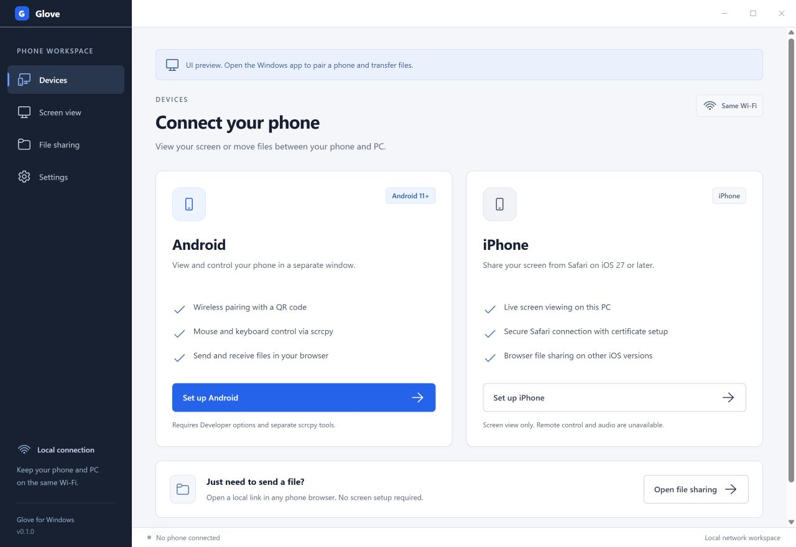

# Glove

**Connect your Android phone or iPhone to your Windows PC over Wi-Fi.**

Glove brings wireless Android screen control, browser file sharing and experimental iPhone screen viewing into one desktop app. The optional local MCP server gives coding agents a way to inspect an Android test device and navigate its UI.

[Website](https://arpanjot-coding.github.io/Glove/) · [Phone compatibility](https://arpanjot-coding.github.io/Glove/compatibility/) · [Setup guide](https://arpanjot-coding.github.io/Glove/setup/) · [MCP documentation](docs/MCP.md)



## What Glove does

- **Android screen control.** Pair with a QR code from Wireless debugging and open the phone in a scrcpy window. Android 11 or newer and the official scrcpy Windows tools are required. Glove also supports an already connected Android emulator for development.
- **File sharing.** Open a Glove link in the phone’s browser and transfer files in either direction. Incoming files go to your chosen receive folder. Uploads are streamed to disk and limited to 2 GiB per file.
- **iPhone screen viewing.** Safari on iOS 27 or newer can share a screen through the experimental local HTTPS viewing flow. The desktop app displays video. This flow still needs physical iPhone verification.
- **Developer testing.** Connect Codex, Claude Code, VS Code or a compatible local stdio MCP client. Select one authorized Android device for PNG screenshots. Enable input explicitly to tap, swipe and press Back.

## Try it on Windows

Glove is a Windows x64 development preview. The portable package is unsigned. Check the [verification notes](docs/VERIFICATION.md) for the test PC’s launch result and current device coverage.

1. Extract the full portable package and open **Glove.exe**.
2. For Android, download and extract the official [scrcpy Windows tools](https://github.com/Genymobile/scrcpy/blob/master/doc/windows.md). In **Settings → Android screen tools**, choose the folder containing `adb.exe` and `scrcpy.exe`.
3. In **Screen view → Android**, follow the Developer options guide. Samsung Galaxy, Google Pixel and other Android models have separate instructions.
4. On the phone, open **Developer options → Wireless debugging → Pair device with QR code**. Use that scanner with Glove’s pairing code. If network discovery fails, use the manual pairing address and the separate connection address shown on the phone.
5. For files, choose **File sharing → Start sharing**. Open its QR code with the phone’s ordinary camera. Stop the session when you finish.

Keep the PC and phone on the same private network. Guest networks and VPNs may block local discovery. File links use unencrypted local HTTP and grant access to the files in that session. [Android Wireless debugging documentation](https://developer.android.com/tools/adb#wireless-adb-android-11)

## iPhone setup

Start the iPhone setup flow in **Screen view**. Open the setup link on the iPhone. Compare the SHA-256 fingerprint of the **actual certificate in the downloaded profile** with the fingerprint shown on your PC before installing or trusting it. If you cannot inspect the fingerprint or it differs, cancel setup.

After trusting the matching certificate, open Glove’s HTTPS screen page in Safari and use the system screen picker. Stop sharing when done. Remove the certificate profile when you no longer use it. File sharing works independently of screen capture. [Apple certificate trust instructions](https://support.apple.com/en-us/102390) · [Safari screen capture compatibility](https://github.com/mdn/browser-compat-data/blob/main/api/MediaDevices.json)

## Test a mobile app with an agent

In **Settings → Developer tools**, refresh the device list, choose the authorized test device and copy the configuration for your MCP client. Run the client on the Windows PC that hosts ADB. The local MCP server needs Node.js 24 or newer.

The [MCP guide](docs/MCP.md) covers Codex, Claude Code, VS Code and enabling basic input. The [Glove mobile QA skill](skills/glove-mobile-qa/SKILL.md) gives an agent a short workflow for device selection, screenshot-based navigation, recovery cases and evidence. Install the skill in your client’s project skills folder or give the file to the agent directly.

## Build from source

Use Node.js 24+ on Windows.

```powershell
npm ci
node node_modules/electron/install.js
npm run build
npm start
```

`npm run dev` runs the development shell. `npm run dev:ui` opens a renderer preview. `npm test` checks Android device discovery and pairing state, file transfers, iPhone signaling and the MCP protocol. `npm run package:win` builds the portable folder at `release/Glove-win32-x64`.

The desktop shell lives in `src/desktop` and the UI in `src/ui`. Local file sharing and iPhone signaling live in `src/sharing` and `src/viewing`. The standalone developer server lives in `src/mcp`. The product site lives in `docs` and publishes through GitHub Pages.

## Compatibility and reports

Check the [compatibility guide](https://arpanjot-coding.github.io/Glove/compatibility/) for requirements and examples from Samsung Galaxy, Google Pixel, OnePlus, Motorola, Xiaomi and other families. Glove’s Wi-Fi Android support depends on the installed OS, Wireless debugging availability and device policy.

For a bug report, include the Windows version, Glove build, phone model and OS, connection type, exact steps and expected result. Share a screenshot from a test account or redact personal details. See [verification notes](docs/VERIFICATION.md) for measured performance and what was exercised on the emulator.

## License

Glove’s original source and its mobile QA skill are available under [MIT](LICENSE). Electron, Chromium, the Fluent icons and other dependencies retain their own licenses. See [third-party notices](THIRD-PARTY-NOTICES.txt). Glove’s Windows app uses a separate installation of scrcpy for Android screen control.