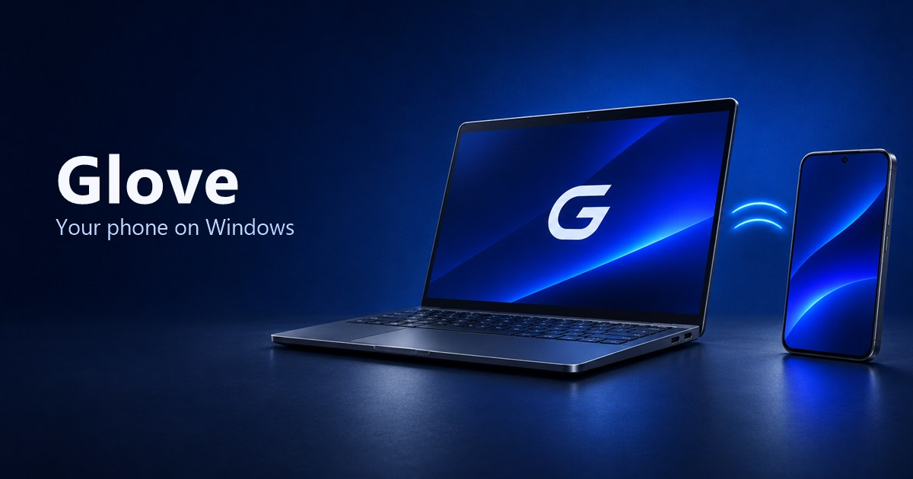
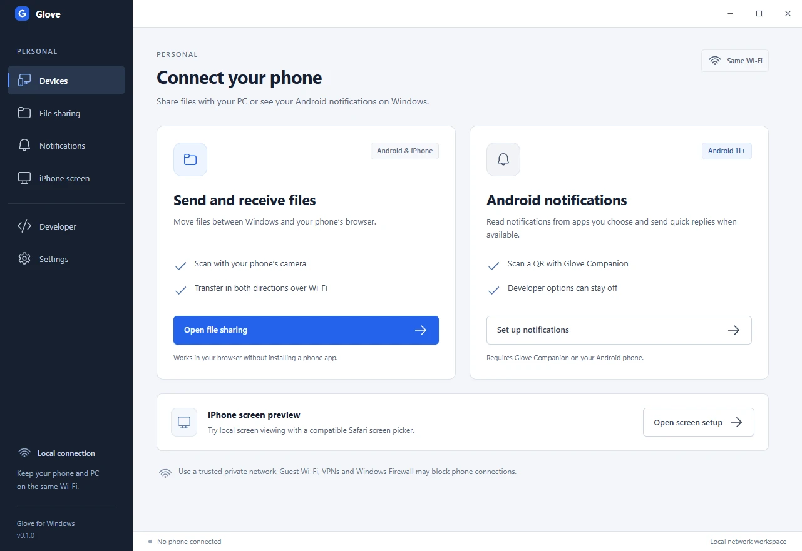
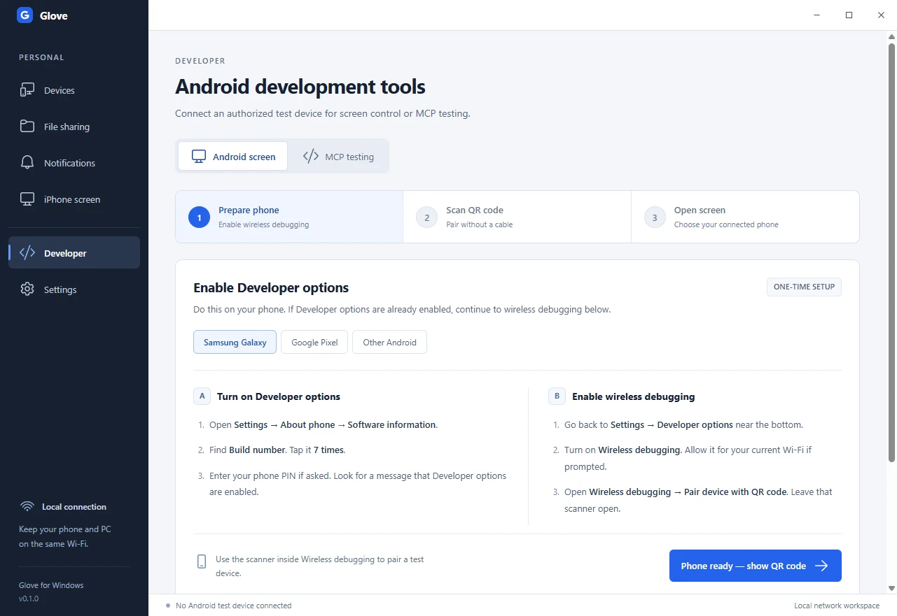
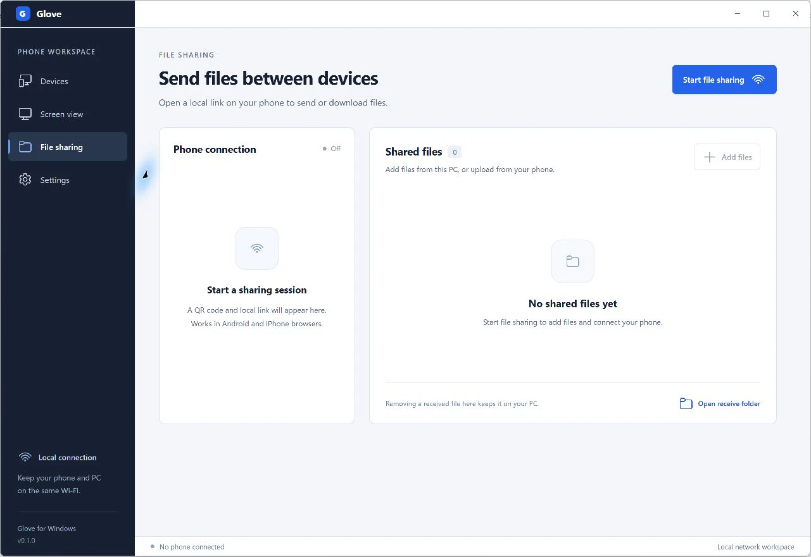

<p align="center">
  <a href="https://arpanjot-coding.github.io/Glove/">
    
  </a>
</p>

<h1 align="center">Glove</h1>

<p align="center"><strong>Phone file sharing, Android notifications, and mobile QA on Windows.</strong></p>

<p align="center">
  <a href="https://arpanjot-coding.github.io/Glove/">Website</a> ·
  <a href="https://arpanjot-coding.github.io/Glove/demos/">Watch the demos</a> ·
  <a href="https://arpanjot-coding.github.io/Glove/setup/">Setup guide</a> ·
  <a href="https://arpanjot-coding.github.io/Glove/compatibility/">Compatibility</a> ·
  <a href="docs/MCP.md">Developer MCP</a>
</p>

Glove is an open-source Windows x64 preview. Transfer files with a phone browser, read and reply to eligible Android notifications, or open the Developer workspace to mirror and test an authorized Android device.

## A look inside Glove



*The Windows desktop app, ready to connect a phone.*

<details>
<summary>See Android setup and file sharing</summary>




</details>

## What you can do

- **Send files in either direction.** Scan a QR with the phone camera and open the link in an Android or iPhone browser. Uploads stream to your selected receive folder. Each file can be up to 2 GiB.
- **Android notifications and quick replies.** Install Glove Companion on Android 11+, scan the Windows pairing QR, and choose which apps can share. Reply from Windows when a notification offers a text reply. This connection uses the normal Android notification access permission. [Companion setup](android/README.md)
- **Mirror and control Android over Wi-Fi.** In Developer, pair by QR from Android's Wireless debugging screen, then open the phone in scrcpy. This flow requires Android 11+ and separately installed scrcpy Windows tools. An authorized Android emulator also works for testing.
- **Try iPhone screen viewing.** The experimental HTTPS session targets Safari on iOS 27+ and needs a compatible system screen picker. Physical iPhone playback is still unverified. The session is view-only.
- **Test an Android app with an agent.** The local MCP server captures PNG screenshots from one selected test device. Enable input to tap, swipe, and press Back. [MCP guide](docs/MCP.md)

## Watch the demos

- **Screen mirroring.** Watch scrcpy record the Android 16 emulator at 864 × 1920. This demo used local emulator ADB transport. [Video](https://arpanjot-coding.github.io/Glove/demos/#screen-mirroring)
- **Agent-driven QA.** Compare before and after screenshots from a real MCP screenshot → tap → screenshot run. [MCP demo](https://arpanjot-coding.github.io/Glove/demos/#developer-testing)
- **File transfer.** A test fixture uploaded and downloaded 8,388,645 bytes per direction. File sizes and SHA-256 hashes matched. [Transfer results](https://arpanjot-coding.github.io/Glove/demos/#file-sharing)

See the [verification notes](docs/VERIFICATION.md) for test conditions and physical-device coverage.

## Get started on Windows

Run `Glove-Setup-x64.exe` if you have a preview installer, then open Glove from Start. Setup installs for your Windows account. The preview is unsigned.

To run from a source checkout, use Node.js 24+ on Windows x64.

```powershell
git clone https://github.com/arpanjot-coding/Glove.git
cd Glove
npm ci
node node_modules/electron/install.js
npm run build
npm start
```

**Files.** In **Personal → File sharing**, start a session and scan its QR with your phone's camera. Keep both devices on the same trusted private network. The file link grants access to that session over local HTTP. Stop sharing when you finish.

**Android notifications.** Open **Personal → Notifications**. Choose **Share Android installer** if your build includes the companion APK, then **Continue to pairing → Pair Android**. Scan that QR inside Glove Companion and approve the matching code on Windows. Grant notification access and select apps on Android. [Companion setup](android/README.md)

**Android screen control.** In **Developer → Android screen**, choose the extracted [scrcpy Windows tools](https://github.com/Genymobile/scrcpy/blob/master/doc/windows.md) and follow the Developer options guide. Use the scanner inside **Wireless debugging → Pair device with QR code**.

**iPhone screen preview.** Follow the setup guide to verify the downloaded certificate fingerprint before trusting the certificate. Remove the certificate profile when you no longer use it. File sharing works independently of screen viewing. [iPhone setup](https://arpanjot-coding.github.io/Glove/setup/#iphone)

## Mobile testing with Codex, Claude Code, or VS Code

Choose an authorized test device in **Developer → MCP testing** and copy the configuration for your local MCP client. Run that client on the Windows PC hosting ADB. The [Glove mobile QA skill](skills/glove-mobile-qa/SKILL.md) gives the agent a workflow for checking the device, taking screenshots, navigating with optional input, and collecting evidence. [MCP guide](docs/MCP.md)

## Compatibility and support

The [compatibility guide](https://arpanjot-coding.github.io/Glove/compatibility/) covers Samsung Galaxy, Google Pixel, OnePlus, Motorola, Xiaomi, and other phone families. Wireless debugging availability depends on the Android version, model, and device policy. See the guide for tested configurations and platform requirements.

Choose **Language** on the [Glove website](https://arpanjot-coding.github.io/Glove/) for the product overview and Windows setup in 12 languages. Edit `docs/locales/` and run `node scripts/build-site-locales.mjs` to regenerate the localized pages and sitemap.

Run `npm test` to check pairing, notification replies, local transfers, iPhone signaling, and the MCP protocol. Use `npm run package:win` for a portable Windows build, or install [NSIS 3.13](https://nsis.sourceforge.io/Download) and run `npm run installer:win` to generate `release/Glove-Setup-x64.exe`. Set `GLOVE_MAKENSIS` to the full compiler path if it is outside PATH. Build the [Android companion](android/README.md) first to bundle its APK. [Report an issue](https://github.com/arpanjot-coding/Glove/issues/new)

## License

Glove's original source and mobile QA skill use the [MIT License](LICENSE). Dependencies retain their own licenses. Glove uses a separate installation of scrcpy for Android screen control. [Third-party notices](THIRD-PARTY-NOTICES.txt)
